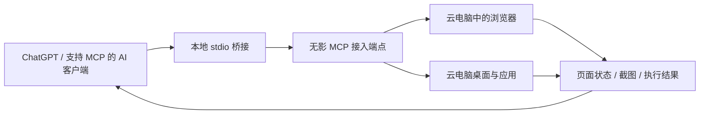

# Wuying MCP Demo · 让 AI 操作真实无影云电脑

[English](README.en.md) · [接入 ChatGPT](docs/chatgpt.md) · [演示任务](examples/scenarios.md)

把无影 MCP 接到支持 MCP 的 AI 客户端：模型理解任务，无影云电脑执行浏览器和桌面操作，截图与工具结果回到对话中。

这是可运行的 **MCP 客户端与桥接示例**。它连接您自己的无影实例，不创建云电脑，也不包含模拟桌面。不是阿里云官方 SDK。

> 验证状态：本地 MCP 协议测试已覆盖 HTTP、SSE、鉴权、工具发现、参数校验、截图透传及 stdio 桥接。2026-10-10 已完成真实无影端点鉴权、工具发现与桌面截图调用；该端点返回 8 个工具，尚未发现浏览器或鼠标键盘工具。ChatGPT 账号连接与交互任务仍待验证。测试服务器仅用于自动化测试。



ChatGPT 连接本地桥接需要 Secure MCP Tunnel；其他支持 stdio 的客户端可以直接启动桥接。[完整连接说明](docs/chatgpt.md)。

## 能演示什么

| 路径 | 交互方式 | 客户能看到的结果 |
| --- | --- | --- |
| Browser Use | 读取页面结构，按当前元素引用导航、点击或输入 | AI 能看到页面并验证操作结果 |
| Computer Use | 查看云电脑截图与窗口，按屏幕坐标操作 | AI 能跨浏览器与桌面应用完成步骤 |
| 人机协作 | 每次操作后观察，必要时由用户确认或接管 | 执行过程可检查，失败时可定位 |

工具是否存在、参数和操作系统支持，以您的端点返回的 `tools/list` 为准。本示例不承诺所有无影版本都提供同一套工具，也不自动替代为本机浏览器操作。

## 三步运行

需要 Node.js 22.9+（或 24 LTS）、正在运行的无影云电脑，以及实际可访问的 MCP 地址和鉴权配置。

```bash
git clone https://github.com/SuncNoob/wuying-mcp-demo.git
cd wuying-mcp-demo
npm ci
cp .env.example .env
```

**1. 填入真实连接配置。** 编辑 `.env`。不要使用云电脑内部的 `127.0.0.1` 地址作为外部连接地址；应使用无影提供的可访问端点，或您已配置的安全网络路径。

默认按 Streamable HTTP 连接。如果交付配置明确使用旧版 SSE，将 `WUYING_MCP_TRANSPORT` 改为 `sse`。仅在端点实际采用 Bearer 时填写 `WUYING_MCP_TOKEN`。

其他请求头鉴权方式：复制 `examples/config.example.json` 为 `config.local.json`，按交付配置修改 `headers`，在 `.env` 中设置 `WUYING_MCP_CONFIG` 的绝对路径。支持 `${ENV_NAME}` 替换，也支持包含 `mcpServers` 的远程服务配置；多服务时设置 `WUYING_MCP_SERVER`。暂不自动启动导出配置中的 `command`，也不实现 OAuth 登录或刷新。

**2. 检查连接和真实工具参数。**

```bash
npm run doctor
npm run tools
```

`doctor` 只初始化连接、读取工具清单，不执行桌面操作。`discovered` 是远端工具总数，`exposed` 是当前权限配置允许的工具数。数量为零时，先检查端点版本或工具名称，不要直接假定已具备桌面控制能力。

**3. 执行一次工具调用，或接入 AI 客户端。**

从清单选择一个实际存在的观察工具，把符合它 `inputSchema` 的参数写入 `arguments.local.json`，然后运行：

```bash
npm run call -- 实际工具名 --args arguments.local.json
```

如果端点提供 `screenshot` 且其 schema 接受空对象，可用 `{}` 调用它。不要把这个示例当作所有版本的参数约定。

调用结果存入被 Git 忽略的 `.artifacts/`，终端只输出文件路径、内容类型和错误状态。截图等 MCP 内容原样保留；如果远端把截图包装成文本，本示例不会擅自猜测或转换其格式。

要让 AI 实际点击或输入，将 `.env` 中 `WUYING_MCP_PROFILE=interactive`，然后重启客户端或桥接。按 [ChatGPT 接入说明](docs/chatgpt.md) 连接，运行 [两个演示任务](examples/scenarios.md)。

## 权限与执行边界

- `observe` 默认仅开放已知的截图、页面结构、窗口列表等观察工具。这些结果仍可能包含桌面上的敏感内容。
- `interactive` 额外开放常见浏览器和桌面操作；不默认开放 shell、任意脚本执行、安装、文件删除或整段自主任务执行工具。
- 若端点使用不同名称，可在本地 JSON 的 `allowTools` 中配置**完整、精确的允许名单**。它会覆盖默认 profile 名单；只添加已检查过 schema 与用途的工具。
- 同一进程一次只执行一个工具调用；多客户端仍可能同时操作同一台云电脑，应为演示分配独立会话。
- 连接与调用有超时，不自动重试。超时不代表云端操作已停止，先检查实际桌面再重试。
- 桥接只输出 MCP 协议到 stdout，不打印连接地址和令牌。工具返回内容会交给 AI 客户端；请使用专用演示环境。

## 项目结构

```text
src/config.mjs       本地配置与环境变量
src/upstream.mjs     无影 MCP 连接、工具发现与调用
src/policy.mjs       工具允许名单
src/bridge.mjs       stdio MCP 服务，供 AI 客户端启动
src/cli.mjs          连接诊断与单工具调试
examples/            演示任务和配置模板
test/                本机协议测试，不是云电脑模拟产品
```

## 验证与常见问题

```bash
npm test
npm audit
```

[验证清单与故障定位](docs/verification.md) 区分协议测试、真实无影验证和 ChatGPT 验证。

本项目不会申请云资源或计算 ROI。无影实例、网络、应用授权及 ChatGPT/Tunnel 所需权限，由使用者自己的环境提供。MIT License。
