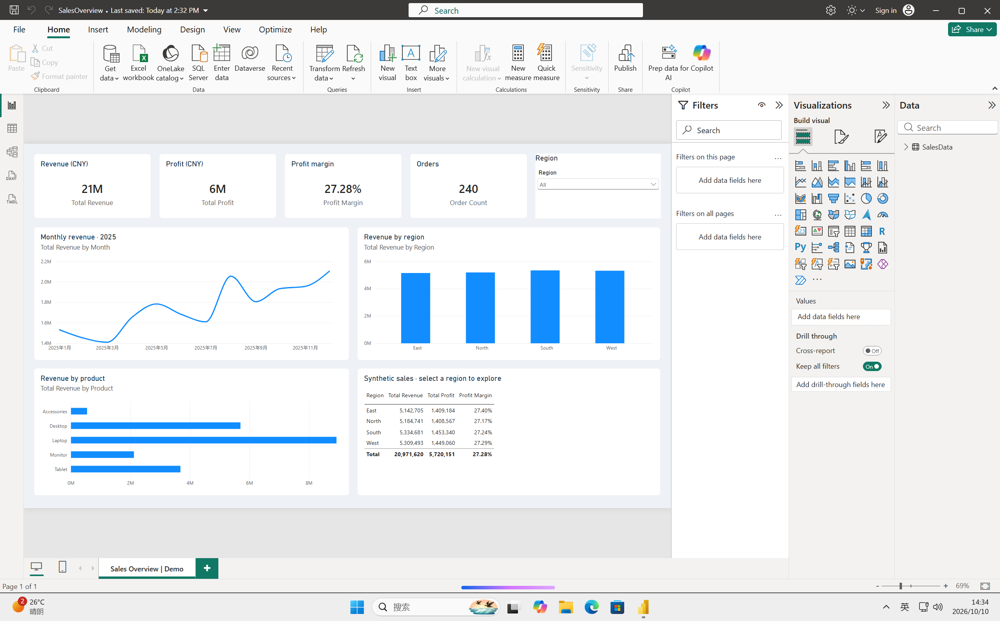
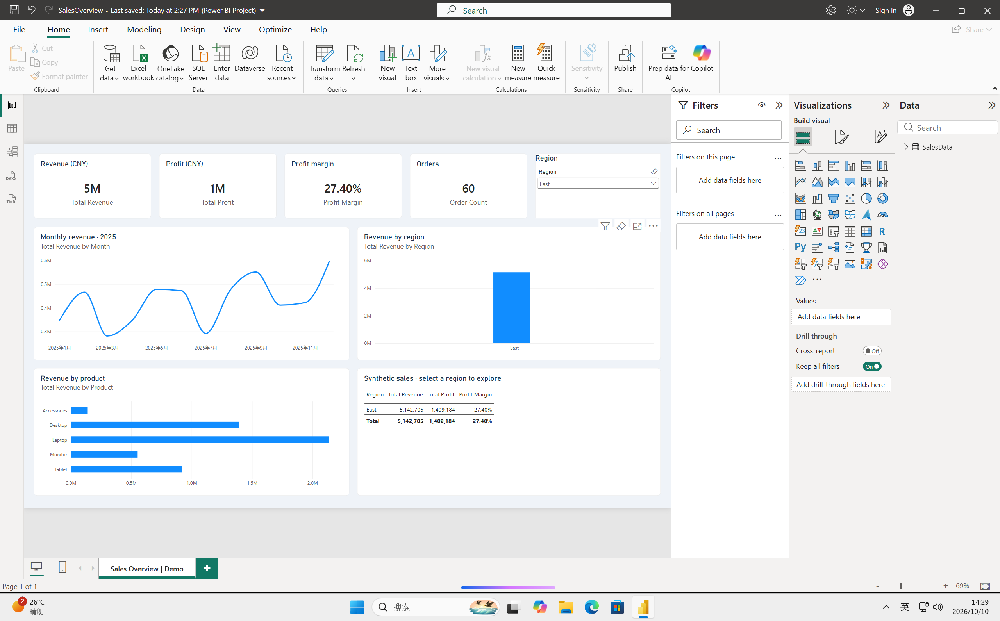

# Windows 实战：让 AI 在无影云电脑中交付 Power BI 销售看板

已在真实无影 Windows 11 云电脑验证：安装 Power BI Desktop → 导入 Excel → 配置原生报表 → 操作区域筛选 → 保存 PBIX → 关闭并重新打开。全部数据均为模拟订单，不含客户数据。

## 阅读导航

- **想先运行：** 阅读本页“直接运行”和“验收步骤”。
- **想了解实际经过：** [完整测试记录](../../docs/powerbi-test-record.md)，包含十个阶段、失败处理、结果和边界。
- **想接入自己的 App：** [MCP 与 App 优化建议](../../docs/mcp-improvements.md)，均为待实现设计。
- **想查看截图报告：** 下载仓库后打开 [report.html](report.html)，GitHub 文件页本身不执行 HTML。

## 无影在这个案例中提供什么

| 能力 | 本次实际使用方式 | 交付结果 |
| --- | --- | --- |
| 远程命令执行 | `aiengine__shell` 调用 PowerShell | 安装应用、启动进程、检查文件 |
| 文件读写 | `aiengine__write_file` / `aiengine__read_file` | 传入 Excel 和报表定义，取回 PBIX 与截图 |
| 桌面应用控制 | 经 shell 使用 Windows UI Automation / Win32 | 导入数据、保存报表、选择 East 区域 |
| 执行结果观察 | 经 shell 截取完整桌面，再读取 PNG | 核对真实应用中的图表与筛选结果 |

这是 **MCP shell + Windows 系统接口** 的实际集成，不依赖端点提供独立的点击工具。AI 负责组织步骤与报表定义；Power BI 负责执行查询、计算和显示。不是纯鼠标录像回放，也不是模拟网页。不同实例的工具和权限以实际 `tools/list` 为准。

## 直接运行

前提：已配置本仓库 `.env`、执行 `npm ci`；云电脑已登录且桌面未锁定；已安装 [Power BI Desktop](https://www.microsoft.com/en-us/download/details.aspx?id=58494)。本例测试版本为 2.158.1304.0。

```bash
npm run demo:powerbi
```

此命令通过真实 MCP 连接上传并校验 `sales-demo.xlsx`、`SalesOverview.pbix`，然后请求启动 Power BI。目标目录固定为 `C:\Users\Public\WuyingMcpDemo\powerbi-sales`，与报表数据源一致。同名文件内容不同则停止，避免覆盖修改后的报表；请先将自己的版本移到其他位置。命令不会自动安装软件，也不把“启动成功”当作看板验证成功。

也可直接下载 [SalesOverview.pbix](SalesOverview.pbix)，在 Windows Power BI Desktop 打开，利用内嵌数据查看和筛选。若要刷新，先把 [sales-demo.xlsx](sales-demo.xlsx) 放到上述目录，或在 Power BI 数据源设置中更改路径。

## 验收步骤与实际结果

1. 打开报表，区域选择 All：240 条订单；表格合计销售额 **20,971,620**，利润 **5,720,151**，利润率 **27.28%**。
2. 右上角 Region 选择 East：订单变为 **60**；销售额 **5,142,705**，利润 **1,409,184**，利润率 **27.40%**；月度趋势和产品图同步变化。
3. 清除区域筛选，恢复全量结果。保存、关闭并重新打开 `.pbix`，确认图表仍可查看。

顶部卡片采用 Power BI 默认缩写显示（如 21M）；精确金额以页面右下表格为准。独立计算的核对值见 [expected.json](expected.json)。





## 客户可以修改什么

- Excel：240 条模拟订单，覆盖 2025 年 12 个月、4 个区域、5 类产品。
- PBIX：直接修改图表、度量值、筛选器或数据源。
- [项目源码](project/SalesOverview.pbip)：原生 PBIP / PBIR / TMDL，适合 Git 版本管理。打开前配置 Excel 路径并执行 Refresh；仓库不包含本机缓存和用户设置。
- [MCP 启动代码](../../src/powerbi-demo.mjs)：文件传输、SHA-256 核验、应用启动的可复用示例。

本次先在桌面导入 Excel，再按微软支持的 [PBIR 格式](https://learn.microsoft.com/en-us/power-bi/developer/projects/projects-report) 配置图表和 TMDL 度量值，最后回到真实应用完成验证。不是一条命令重新执行从安装到报表设计的全部过程；`demo:powerbi` 复用已经验证的报表文件。

本次遇到的安装超时、截图缩放、文件名输入未生效、隐藏控件和保存定位问题，见[测试经过与故障处理](../../docs/powerbi-test-record.md#遇到的问题与解决经验)。本页聚焦运行步骤，避免将测试过程与客户操作步骤混在一起。

## English

A real Windows application case on Wuying: Power BI Desktop installation, Excel import, editable native report authoring, live region filtering, PBIX saving and reopening. All 240 orders are synthetic.

Run `npm run demo:powerbi` after configuring this repository and installing Power BI on the cloud PC. The command transfers the supplied workbook and PBIX, checks SHA-256 hashes, and requests application launch. It does not reinstall Power BI or recreate the report through UI automation. Manually check All (240 orders, CNY 20,971,620) and East (60 orders, CNY 5,142,705). Screenshots above record the actual verified run, not output from every future invocation.
